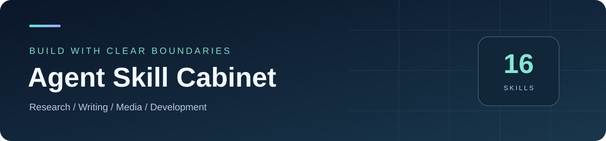

# 自制 Agent 技能柜

**从资料到检索，从小说到短剧，从需求到交付。**

17 套独立技能 · 中文使用指南 · 明确输入输出与能力边界

[开始使用](docs/getting-started.md) · [浏览技能](#技能目录) · [组合流程](PIPELINE.md) · [常见问题](docs/faq.md) · [验证范围](docs/verification.md)

[**下载完整 ZIP**](https://codeload.github.com/ningmengningmeng233-sys/my-agent-skills/zip/refs/heads/main) · [查看版本清单](catalog.json)

> **先选一套，用小样本跑通。** 每套技能独立安装；账号、模型、客户端与本地数据按对应指南准备。目录收录和工程检查不等于完整真实业务验收。

## 从这里开始

| 你的目标 | 推荐路线 |
| --- | --- |
| 视频、消息转成可整理资料 | B 站转录 / 抖音转录 / Telegram 归档 |
| 在原文里定位知识、情节和作者风格 | 知识库转录 / 小说索引 / 成人文学索引 |
| 修改中文表达、组织小说改编 | 去 AI 味 / 日系小说本地化 / 小说转短剧 |
| 准备视频提示词、资产与成片计划 | MiniMax H3 / 资产提取 / 成片合成 |
| 管理研发流程与本地工具能力 | 柠檬思考 / 技能优化 / UMH / RTK |

## 技能目录

**使用指南**面向使用者，包含准备条件、步骤、示例、边界和排错；**技能入口**供支持 Agent Skills 的宿主读取。版本与状态以 catalog 为准。

### 资料采集与检索

| 产品与使用指南 | 版本 | 用途 / 提醒 | 技能入口 |
| --- | --- | --- | --- |
| [B 站转录](docs/skills/bilibili-auto-transcript.md) | 5.5.5 | 音视频 · 字幕与识别 | [SKILL.md](B站转录_v5.5.5/SKILL.md) |
| [抖音转录](docs/skills/douyin-auto-transcript.md) | 2.0.6 | 音视频 · 批次与恢复 | [SKILL.md](抖音转录_v2.0.6/SKILL.md) |
| [Telegram 归档](docs/skills/tg-transcript.md) | 1.0.2 | 消息归档 · 附件整理 | [SKILL.md](tg转录_v1.0.2/SKILL.md) |
| [知识库转录](docs/skills/knowledge-index.md) | 5.4.8 | 非虚构资料 · 可追溯问答 | [SKILL.md](知识库转录_v5.4.8/SKILL.md) |
| [小说索引](docs/skills/novel-index.md) | 4.6.2 | 小说资料 · 分段与检索 | [SKILL.md](小说索引_v4.6.2/SKILL.md) |
| [成人文学索引](docs/skills/adult-literature-index.md) | 4.8.6 | 小说资料 · 作者风格 | [SKILL.md](成人文学索引_v4.8.6/SKILL.md) |
| [知识转录索引](docs/skills/transcript-index.md) | 1.5.0 | 转录资料 · 待独立核验 | [SKILL.md](知识转录索引_v1.5.0/SKILL.md) |

### 文本与短剧制作

| 产品与使用指南 | 版本 | 用途 / 提醒 | 技能入口 |
| --- | --- | --- | --- |
| [去 AI 味](docs/skills/lieflat-less-ai-tone.md) | 2.0.2 | 文本编辑 · 保留作者声音 | [SKILL.md](去AI味_v2.0.2/SKILL.md) |
| [日系小说本地化](docs/skills/jp-novel-localization.md) | 4.5.6 | 中文编辑 · 连载流程 | [SKILL.md](日系小说本地化_v4.5.6/SKILL.md) |
| [小说转短剧](docs/skills/dramacraft.md) | 1.5.5 | 创作流程 · 大纲到分镜 | [SKILL.md](小说转短剧_v1.5.5/SKILL.md) |
| [MiniMax H3 提示词](docs/skills/minimax-h3-craft.md) | 7.4.6 | 视频提示词 · 规则审计 | [SKILL.md](MiniMaxH3提示词_v7.4.6/SKILL.md) |
| [资产提取](docs/skills/asset-extract.md) | 2.17.0-rc.7 | 文本资产 · 公开能力受限 | [SKILL.md](资产提取_v2.17.0-rc.7/SKILL.md) |
| [成片合成](docs/skills/media-assembly.md) | 0.1.4 | 媒体工程 · 计划与组装 | [SKILL.md](成片合成_v0.1.4/SKILL.md) |

### 研发与客户端辅助

| 产品与使用指南 | 版本 | 用途 / 提醒 | 技能入口 |
| --- | --- | --- | --- |
| [柠檬思考](docs/skills/lemon-thinking.md) | 1.1.5 | 研发流程 · 阶段对齐 | [SKILL.md](柠檬思考_v1.1.5/SKILL.md) |
| [技能优化](docs/skills/skill-optimization.md) | 1.0.1 | 工程审查 · 受控精简 | [SKILL.md](技能优化_v1.0.1/SKILL.md) |
| [全局记忆 UMH](docs/skills/universal-memory-hub.md) | 1.0.2 | 跨客户端 · 本地记忆 | [SKILL.md](全局记忆UMH_v1.0.2/SKILL.md) |
| [RTK 压缩器](docs/skills/rtk-token-reducer.md) | 92cc75f-r2 | 开发工具 · 输出压缩 | [SKILL.md](rtk-token-reducer_v92cc75f-r2/SKILL.md) |

## 下载后怎么用

1. 下载 ZIP 并解压，或克隆仓库；选择需要的**完整技能目录**。
2. 阅读上表的使用指南，按原始安装文档准备宿主、依赖与配置。
3. 先检查环境，再用一个小样本核对状态和实际产物，最后才扩大批次。

详细步骤、安装与脚本的区别、更新和备份方法见[从下载到第一次使用](docs/getting-started.md)。无需安装全部 17 套，也不要只复制一个 SKILL.md。

## 使用前需要知道

- **外部服务与费用**：索引、改写、识别和生成按实际配置调用本地或外部能力；先确认账号、内容授权、隐私和预算。
- **数据与恢复**：密钥、Cookie、会话、原稿和数据库留在本机；改写、批处理和更新前备份数据及状态。
- **资产提取公开档**：排除 32 张受限风格/来源图，相关视觉能力不可用；完整发布校验仍有缺口，不能按完整视觉发行包理解。
- **知识转录索引**：历史来源与独立验收尚未闭合，保留待核验状态，只建议隔离试用。
- **系统与宿主**：完整跨系统、多宿主和真实账号链路尚无统一全部通过结论；请按接收者环境验证。

更多已知问题见[验证范围与限制](docs/verification.md)，下载或运行失败先看[常见问题](docs/faq.md)。

<strong>许可、第三方组件与引用</strong>

各产品和第三方组件分别遵循自己的许可、来源与分发声明，本仓库不统一授予 MIT。公开可下载不自动表示可商用、可转授权或可重新分发素材。B 站转录的 README 与入口许可表述冲突仍待裁决。使用具体组件前请查看所在包的许可文件、UPSTREAM、PROVENANCE 或 THIRD_PARTY_NOTICES。

---

介绍页更新：2026-10-16。当前目录身份见 [catalog.json](catalog.json)；本页完善不改变技能运行代码和既有验收状态。
