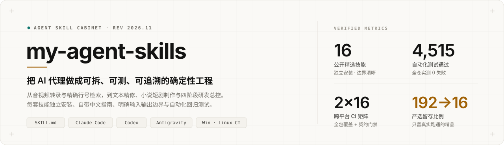

<div align="center">

<picture>
  <source media="(prefers-color-scheme: dark)" srcset="docs/assets/hero-dark.svg" />
  <source media="(prefers-color-scheme: light)" srcset="docs/assets/hero-light.svg" />
  
</picture>

<br />

[设计理念](#设计理念) · [系统架构](#系统架构) · [16 套技能详解](#技能详解) · [组合产线](PIPELINE.md) · [快速上手](#快速上手) · [验证边界](#验证边界与许可)

[**下载完整 ZIP**](https://codeload.github.com/ningmengningmeng233-sys/my-agent-skills/zip/refs/heads/main) · [版本清单](catalog.json) · [安装指南](docs/getting-started.md) · [常见问题](docs/faq.md)

<br />

[](https://github.com/ningmengningmeng233-sys/my-agent-skills/actions/workflows/ci.yml)

</div>

<br />

> **先选一套，用小样本跑通。** 仓库收录 16 套独立打包的中文 Agent 技能，面向 **Claude Code**、**Codex** 与 **Antigravity** 等支持 `SKILL.md` 的客户端。没有臃肿的统一运行时，按需取用、各自独立验证；每一步产出都可核对、可中断、可恢复。

---

## 设计理念

把施工现场的**工序拆解、质量验收、过程留痕与风险控制**带进 AI 代理工作流，拒绝“写一段模糊提示词碰运气”。

<table>
  <tr>
    <td width="33.3%" valign="top">
      <p><sub><strong>01 · 工序解耦</strong></sub></p>
      <p><strong>单点独立，契约串联</strong></p>
      <p>每套技能都是完整自治的独立目录，明确定义输入与交付物；既可单独解决一个具体痛点，也能通过 <code>schemas/</code> 共享数据契约首尾相接。</p>
    </td>
    <td width="33.3%" valign="top">
      <p><sub><strong>02 · 测试与门禁</strong></sub></p>
      <p><strong>红绿推进，全仓回归</strong></p>
      <p>核心流程以测试先行与静态契约护航。全仓 <strong>4,514</strong> 项自动化测试覆盖业务逻辑、跨技能接口与发布身份，并接入 Windows / Linux 双平台 CI 矩阵。</p>
    </td>
    <td width="33.3%" valign="top">
      <p><sub><strong>03 · 诚实留痕</strong></sub></p>
      <p><strong>绝不用占位符伪造完成</strong></p>
      <p>严格区分“本地工程通过”与“真实业务验收”。所有重操作默认保留原始文件、状态数据库与断点证据，遇到缺项立刻停在边界处。</p>
    </td>
  </tr>
</table>

<br />

<picture>
  <source media="(prefers-color-scheme: dark)" srcset="docs/assets/protocol-dark.svg" />
  <source media="(prefers-color-scheme: light)" srcset="docs/assets/protocol-light.svg" />
  
</picture>

---

## 系统架构

16 套技能沿一条清晰的内容生产主线展开——从**音视频与消息采集**、**精确行号索引**、**文本精修与剧本改编**到**视频提示词、资产账本与成片合成**；下方由 4 套**研发流程与客户端底座**横向支撑日常工程协作。

<br />

<picture>
  <source media="(prefers-color-scheme: dark)" srcset="docs/assets/architecture-dark.svg" />
  <source media="(prefers-color-scheme: light)" srcset="docs/assets/architecture-light.svg" />
  
</picture>

<br />

### 按你的目标快速选型

| 你的目标 | 推荐技能组合 | 定位入口 |
| :--- | :--- | :--- |
| 把 B 站 / 抖音视频、Telegram 群聊沉淀为可阅读、可归档的文字资料 | B 站转录 · 抖音转录 · Telegram 归档 | [01 · 资料采集与归档](#01--资料采集与归档) |
| 对几百万字书籍、教程、小说或转录稿做精确到原句行号的本地问答检索 | 知识库转录 · 小说索引 · 知识转录索引 | [02 · 溯源索引与本地检索](#02--溯源索引与本地检索) |
| 消除文稿机械 AI 腔、润色日式翻译腔，或把小说改编成结构化短剧分集剧本 | 去 AI 味 · 日系小说本地化 · 小说转短剧 | [03 · 文本精修与剧本改编](#03--文本精修与剧本改编) |
| 审核视频生成提示词、提取跨章节人物场景资产、串联分镜配音生成成片计划 | MiniMax H3 提示词 · 资产提取 · 成片合成 | [04 · 视觉提示词、资产与成片](#04--视觉提示词资产与成片) |
| 规范 AI 研发四阶段流程、安全精简膨胀代码、跨客户端共享记忆、压缩终端日志 | 柠檬思考 · 技能优化 · 全局记忆 UMH · RTK 压缩器 | [00 · 研发流程与客户端底座](#00--研发流程与客户端底座) |

> 想了解多套技能如何跨工序衔接、如何核对交接字段，请阅读 [组合流程说明（PIPELINE.md）](PIPELINE.md)。

---

## 技能详解

每套技能下均提供**中文使用指南**（含环境准备、小样本演练、排错表与能力边界）和**技能入口 `SKILL.md`**（供支持 Agent Skills 的宿主客户端直接加载）。版本号以根目录 [catalog.json](catalog.json) 为唯一权威。

---

### 01 · 资料采集与归档

> 把分散在视频平台与即时通讯软件中的音视频和消息，稳定沉淀为本地可检索、可回溯的文字与附件归档。

| 技能与中文指南 | 版本 | 一句话定位 | 技能入口 |
| :--- | :--- | :--- | :--- |
| [B 站转录](docs/skills/bilibili-auto-transcript.md) | `5.5.6` | 字幕优先、识别兜底的 B 站视频与收藏夹批量转录 | [SKILL.md](B站转录_v5.5.6/SKILL.md) |
| [抖音转录](docs/skills/douyin-auto-transcript.md) | `2.0.7` | 带批次预览、状态库与断点续传的抖音视频转录 | [SKILL.md](抖音转录_v2.0.7/SKILL.md) |
| [Telegram 归档](docs/skills/tg-transcript.md) | `1.0.3` | 面向聊天记录与附件的增量导出、导入与阅读归档 | [SKILL.md](tg转录_v1.0.3/SKILL.md) |

#### B 站转录 · `bilibili-transcript`
- **核心作用**：把 B 站单个视频、多 P 合集或整个收藏夹自动转成干净的本地文稿与结构化归档，方便做课程笔记、知识沉淀或直接喂给下游检索库。
- **核心机制与亮点**：采用“官方/AI 字幕优先，无字幕再回退本地语音识别（Faster-Whisper）”的省时策略；内置本地 SQLite 归档数据库记录每个视频与分 P 的状态，支持去重、失败重试以及可选的摘要补齐。
- **输入 → 交付产物**：输入 B 站视频链接（支持 `?p=N`）或收藏夹配置 → 输出标准转录 TXT、原始字幕/识别记录、归档状态库与摘要信息（依赖 Python ≥ 3.10、FFmpeg 与可选识别模型）。

#### 抖音转录 · `douyin-auto-transcript`
- **核心作用**：把抖音分享链接、整段分享文案或批量链接清单，自动解析并整理为带时间戳的转录文本与摘要，适合短视频拆解、文案研究与素材留档。
- **核心机制与亮点**：内建完整的工程批次治理——单批新增超过 10 条或预计耗时超过 30 分钟时自动暂停并输出预览等待确认；支持按 `batch_id` 断点续跑（`--resume`）与仅重试失败项（`--retry-failed`），明确区分登录失效、限流、待人工复核等中间状态，且保留原始 ASR 文本不被覆盖。
- **输入 → 交付产物**：输入单条抖音链接/分享文案，或批量清单 TXT → 输出主转录 TXT、时间戳与原始识别记录、批次状态库及按需开启的摘要/OCR 增强产物（需 Python ≥ 3.12、FFmpeg 与按需浏览器登录）。

#### Telegram 归档 · `tg-transcript`
- **核心作用**：针对 Telegram 频道、群组或私聊消息，按明确对象与时间范围完成导出、离线导入和分类整理，把容易被刷走的精华讨论和文件变成长期可用的本地资料库。
- **核心机制与亮点**：通过声明式 `task.json` 严格限定抓取边界与媒体类型，支持任务状态留痕、断点恢复、增量更新与预设模板；同时兼容在线工具（`tdl`）导出和离线解析已有的 Telegram Desktop / `tdl` JSON 文件，避免重复拉取与误操作。
- **输入 → 交付产物**：输入目标会话、时间范围与导出配置（或已有导出 JSON） → 输出原始消息数据、整理后的附件目录、可读视图、可检索库或脱敏分享副本（注：本入口聚焦消息与附件归档，不承诺内建语音识别）。

---

### 02 · 溯源索引与本地检索

> 把动辄数十万、数百万字的长篇文档与小说切分建库，让 AI 问答**句句回读原文、精确标注出处行号**，从机制上压制幻觉。

| 技能与中文指南 | 版本 | 一句话定位 | 技能入口 |
| :--- | :--- | :--- | :--- |
| [知识库转录](docs/skills/knowledge-index.md) | `5.4.9` | 面向非虚构书籍、手册与课程笔记的可追溯本地问答库 | [SKILL.md](知识库转录_v5.4.9/SKILL.md) |
| [小说索引](docs/skills/novel-index.md) | `4.6.3` | 面向超长篇小说的章节分段、追更同步与精准定位检索 | [SKILL.md](小说索引_v4.6.3/SKILL.md) |
| [知识转录索引](docs/skills/transcript-index.md) | `1.5.1` | 专用于本地 B 站转录目录的只读索引、校对与向量检索 | [SKILL.md](知识转录索引_v1.5.1/SKILL.md) |

#### 知识库转录 · `knowledge-index`
- **核心作用**：把长篇非虚构资料（教材、技术手册、行业研报、课程逐字稿、研究笔记）自动切段并建立结构化目录与语义索引，支持对超大资料库进行高可信度的溯源问答。
- **核心机制与亮点**：强调“索引指路，原文作答”——检索命中候选段落后强制回读原文并附带精确行号区间校验（KB-01 严格自区间检查），杜绝 AI 凭模糊印象瞎编；支持多节点 API 故障转移池（`api_pool`）、跨平台路径规范化防重，以及安全的原文文件前缀匹配。
- **输入 → 交付产物**：输入 TXT / Markdown 非虚构文档（PDF/Word/EPUB 需经转换核对）、书名与作者信息 → 输出规范化原文段文件、段落索引、全书导航视图、SQLite 状态库与语义索引。

#### 小说索引 · `novel-index`
- **核心作用**：专为长篇小说与连载作品设计的本地检索系统，帮你在一两百万字的小说里秒级定位某个伏笔、人物出场、对话原句或设定变化，支持持续追更新章节。
- **核心机制与亮点**：按章节与自然段落建立稳定的原文段文件与全书导航树，并维护独立的用户数据目录；支持连载追更时的增量同步与库健康维护，既适合普通读者查剧情，也为后续小说改编短剧或同人创作提供“零走样”的设定查证底座。
- **输入 → 交付产物**：输入小说 TXT / Markdown 文本、书名与作者信息 → 输出分章原文段、章节摘要与全书索引、检索元数据及本地检索入口。

#### 知识转录索引 · `knowledge-transcript-index`
- **核心作用**：衔接“B 站转录”的下游专用检索工具，针对 Obsidian 或本地资料夹中带 BV 号的 B 站转录文稿，构建本地索引库、可读校对版与语义向量库。
- **核心机制与亮点**：内置三道默认安全开关——`STRICT_BILIBILI=1`（仅处理合规 BV 号文件）、`ALLOW_SOURCE_WRITE=0`（严禁回写修改你的原始转录稿）、`AUTO_TERM=0`（不私自篡改术语表）；具备未配置 `SRC_DIR` 时的延迟拦截保护和零第三方依赖的容错 JSON 解析器，离线核心测试全绿。
- **输入 → 交付产物**：输入本地包含 BV 号的 B 站转录 TXT 目录 → 输出结构化索引库、校对阅读稿与本地向量检索库（提示：离线核心逻辑已通过回归，真实 Obsidian 目录与嵌入模型仍建议先隔离小样本 `--dry-run` 核验）。

---

### 03 · 文本精修与剧本改编

> 专攻中文表达质感与长篇改编——既能让机器味浓重的文字恢复真人呼吸感，也能把长篇小说一步步拆成可投产的分集短剧剧本。

| 技能与中文指南 | 版本 | 一句话定位 | 技能入口 |
| :--- | :--- | :--- | :--- |
| [去 AI 味](docs/skills/lieflat-less-ai-tone.md) | `2.0.3` | 剔除中文模板腔、死守事实与作者原声的审校改写工具 | [SKILL.md](去AI味_v2.0.3/SKILL.md) |
| [日系小说本地化](docs/skills/jp-novel-localization.md) | `4.5.7` | 消除日式翻译腔的连载章节工作区与人机审批改写流 | [SKILL.md](日系小说本地化_v4.5.7/SKILL.md) |
| [小说转短剧](docs/skills/dramacraft.md) | `1.5.6` | 从大纲、人设、美术到分集剧本与分镜的短剧创作产线 | [SKILL.md](小说转短剧_v1.5.6/SKILL.md) |

#### 去 AI 味 · `lieflat-less-ai-tone`
- **核心作用**：专门审阅并改写带有明显“AI 翻译腔 / 排比空话 / 机械总结”的中文或中英混合文稿，把干瘪套话还原成自然、克制、像真人写出来的中文，同时支持“只提修改建议”或“带备份的文件级改写”。
- **核心机制与亮点**：择优吸收上游 `humanizer v4.0.0+` 的口语声音保护与空洞收尾识别规则，同时**明确拒绝编造事实条款**——宁可少改，也绝不篡改原文数据、观点与叙述视角；内置机械规则体检与可选的语义相似度复核，文件模式下必须先预览差异并由人工确认后才提交落盘。
- **输入 → 交付产物**：输入原文、必须保留的事实/术语清单与期望改写强度 → 输出逐条审校报告或洁净改写稿、机械体检结果及改前原稿备份。

#### 日系小说本地化 · `jp-novel-localization`
- **核心作用**：针对带有明显日式轻小说/机翻痕迹（如拗口敬语直译、过长倒装定语、生硬心理独白）的中文初稿，系统性地重构为符合中文网文阅读习惯与叙事节奏的连载章节。
- **核心机制与亮点**：拒绝“整本书一把梭哈乱改”——内置完整的连载工作区工程流（边界确认 → 单章候选改写 → 专名与事件一致性检查 → 人工审批 → 安全合并/分章），牢牢锁定人名、世界观专名与关键剧情事件不跑偏；支持模型路由配置与执行前 `doctor` 环境自检。
- **输入 → 交付产物**：输入带翻译腔的中文原稿、章节范围、目标文风与专名约束表 → 输出逐章候选本地化稿件、质量与一致性检查记录、审批状态账本及合并成品（当前入口面向 Windows PowerShell 环境）。

#### 小说转短剧 · `dramacraft`
- **核心作用**：面向短剧/漫剧创作者的一站式改编工作流，把原著小说和结构化大纲转化为节奏紧凑、逐字可演的分集剧本，并产出完整的质量评估报告。
- **核心机制与亮点**：主技能下完整配备 **5 个专用子技能**，分别承接**大纲拆解、人物小传、美术风格设定、分集剧本撰写与镜头分镜**五大环节，形成标准化短剧编剧流水线；每一步均受共享契约约束，输出可直接交给下游的提示词审计、资产登记与成片合成模块。
- **输入 → 交付产物**：输入小说原著、`outline.json`、目标集数、单集时长与题材风格要求 → 输出结构化分集剧本（Markdown / CSV / JSON / HTML 多格式导出）、质量体检报告以及下游分镜与投产提示词。

---

### 04 · 视觉提示词、资产与成片

> 承接剧本与分镜，把文字资产、视频模型规则审计和音画合成计划全部结构化、账本化，消除多镜头制作中的“画风漂移”与“口径打架”。

| 技能与中文指南 | 版本 | 一句话定位 | 技能入口 |
| :--- | :--- | :--- | :--- |
| [MiniMax H3 提示词](docs/skills/minimax-h3-craft.md) | `7.4.6` | 面向 MiniMax H3 系列视频模型的提示词编排与 614 项规则审计 | [SKILL.md](MiniMaxH3提示词_v7.4.6/SKILL.md) |
| [资产提取](docs/skills/asset-extract.md) | `2.17.0-rc.8` | 跨章节人物、场景、道具与服饰事实提取及连续性账本（公开文本档） | [SKILL.md](资产提取_v2.17.0-rc.8/SKILL.md) |
| [成片合成](docs/skills/media-assembly.md) | `0.1.5` | 消费分镜、配音与资产账本的渲染计划生成与分阶段组装 | [SKILL.md](成片合成_v0.1.5/SKILL.md) |

#### MiniMax H3 提示词 · `minimax-h3-craft`
- **核心作用**：把故事片段、分镜脚本与参考图需求，精准编排为符合 MiniMax H3 / H3-Max / H3-Max-Turbo 模型规范的视频生成提示词，并对已有提示词进行严格上线前审计，减少抽卡浪费。
- **核心机制与亮点**：以包内 `config/model-capabilities.json` 为客观准绳，严格区分不同型号在镜头运动、单镜时长、台词口型与参考图模式上的真实能力边界，内置 **614 项静态规则回归测试**自动拦截超限参数、字段冲突与漏补资料；本技能聚焦提示词编写与规则体检，实际渲染仍由你的外部视频平台完成。
- **输入 → 交付产物**：输入分镜要求、目标模型与模式、画风、时长、台词与参考图说明 → 输出按模式编排好的标准提示词、规则审计通过/拦截报告及待补充清单。

#### 资产提取 · `asset-extract`
- **核心作用**：从长篇小说中系统抽取人物外貌、服饰变化、核心场景与关键道具等视觉资产事实，为每个实体分配稳定 ID、关系图谱与过程账本，解决长篇改编中“主角换场就变脸、衣服前后对不上”的连续性难题。
- **核心机制与亮点**：支持 TXT / Markdown / DOCX / EPUB 多格式规范化输入与 `--dry-run` 步骤预览；全过程落盘 `.process` 状态与账本数据库，每条资产描述均可回溯原文章节，并生成可衔接下游的标准化文本提示词。
- **输入 → 交付产物**：输入按顺序排好的小说文本与题材/风格参数 → 输出文本资产登记库、跨章节关系与服饰状态索引、结构化提示词及过程账本（**公开档边界提示**：按 `CAPABILITIES.md` 已排除 32 张仅授权本机私用的受限风格参考图，因此公开档仅涵盖文本与离线能力，保持 `-rc.8` 预发布号）。

#### 成片合成 · `media-assembly`
- **核心作用**：作为小说转视频产线的最后一道总装环节，读取上游交付的分镜表、配音表和资产账本，先做全量字段对账并产出渲染执行计划，再分阶段调度视频生成、语音合成、口型对齐与 FFmpeg 剪辑组装。
- **核心机制与亮点**：坚持“先对账出计划，再按阶段执行”的工程纪律——默认自带离线 `stub` 模式方便你在零费用下演练整条流水线；每个阶段独立记录失败项与产物状态，不会因为某一镜头失败而拖垮整条片子。
- **输入 → 交付产物**：输入上游产出的 `storyboard.json`、`dubbing.json` 与 `asset_ledger.json` → 输出 `render_plan` 渲染计划、逐项状态/失败日志，以及接入真实视频/TTS/FFmpeg 后端后的分阶段媒体与成片文件。

---

### 00 · 研发流程与客户端底座

> 支撑整个技能柜与日常 AI 编程协作的底层设施：管住 Agent 的研发纪律、精简膨胀的代码库、打通多客户端记忆、削减无效终端 Token 账单。

| 技能与中文指南 | 版本 | 一句话定位 | 技能入口 |
| :--- | :--- | :--- | :--- |
| [柠檬思考](docs/skills/lemon-thinking.md) | `1.2.0` | 物理文件证据驱动的四阶段 AI 研发总控与全流程纪律 | [SKILL.md](柠檬思考_v1.2.0/SKILL.md) |
| [技能优化](docs/skills/skill-optimization.md) | `1.1.0` | 基于依赖图谱与静态审计的受控代码瘦身与重构审查 | [SKILL.md](技能优化_v1.1.0/SKILL.md) |
| [全局记忆 UMH](docs/skills/universal-memory-hub.md) | `1.0.3` | 跨多个本机 AI 客户端的本地记忆共享服务与诊断工具 | [SKILL.md](全局记忆UMH_v1.0.3/SKILL.md) |
| [RTK 压缩器](docs/skills/rtk-token-reducer.md) | `92cc75f-r3` | 终端长输出无损折叠与原文可回读的省 Token 钩子工具 | [SKILL.md](rtk-token-reducer_v92cc75f-r3/SKILL.md) |

#### 柠檬思考 · `lemon-thinking`
- **核心作用**：AI 研发项目的全流程总控大脑——无论你是做新功能、修复杂 Bug 还是大重构，它都会先静默扫描工作区里的物理文件证据（设计稿、工单、测试与代码），自动判定当前处于哪个研发阶段，再带领人机严格按步骤推进。
- **核心机制与亮点**：已完整同步上游 `obra/superpowers v7.0.2` 核心工程规范，形成**需求拷问对齐 → 原子工单拆解 → TDD 红绿推进 → 终验对抗交付**单向棘轮状态机；杜绝“没对齐需求就盲写代码”“跳过失败测试直接糊弄修 Bug”等 AI 常见毛病，并内含模块化子流程供总控按需调度。
- **输入 → 交付产物**：输入项目目标、当前工作区目录与授权范围 → 输出客观阶段判定、设计方案文档、可验证的原子实施工单、全绿测试证据与交接阻塞清单。

#### 技能优化 · `skill-optimization`
- **核心作用**：专治“项目越写越胖、重复脚本满地跑、想精简又怕删坏主逻辑”的工程代码瘦身审查器，帮你用客观工具证据定位冗余模块，只在明确获准的范围内动手精简并严格复核。
- **核心机制与亮点**：已同步上游 `DietrichGebert/ponytail v5.3.3+` 审计体系，串联 `Graphify-Jev`（结构依赖图谱）、`Ponytail`（冗余与复杂度审计）与独立 `Reviewer`（变更复核）三段证据链；缺工具时老实报告阻塞，绝不拿口头猜测冒充静态分析结论。
- **输入 → 交付产物**：输入目标代码仓库、优化目标、必须保留的核心行为与回归测试 → 输出依赖结构证据、按优先级排序的瘦身清单、获准范围内的受控代码精简与回归验证记录。

#### 全局记忆 UMH · `universal-memory-hub`
- **核心作用**：在一台电脑上同时使用多个 AI 编程/对话客户端（如 Cherry、Qoder、ZCode、Codex、MiniMax、DSH 等）时，为你建立一个本地运行的统一记忆中枢，让项目偏好、常用规范和上下文不用在每个工具里反复重新解释。
- **核心机制与亮点**：纯本地托管数据（默认 `~/.umh`），自带完整性分发校验（`verify-bundle.mjs` 与 `setup.mjs --check` 覆盖 4,349 项文件双向对账）、服务启停管理与逐客户端信任范围审阅；不私自上传个人对话，需要你逐端确认并做测试记忆写入/回读验证。
- **输入 → 交付产物**：输入明确允许保存的长期记忆与本机客户端接入配置 → 输出本地记忆存储库、跨端检索接口、服务健康诊断与连接状态记录（需 Node.js ≥ 24.2 与 Python ≥ 3.12；Claude 原生兼容性目前保持未验证声明）。

#### RTK 压缩器 · `rtk-token-reducer`
- **核心作用**：挂接在 CLI 工具执行链路上的终端输出压缩钩子——当你运行构建、全量测试或 `git diff` 吐出几千行刷屏日志时，自动把噪音行折叠成高密度摘要，大幅节省上下文窗口与 Token 费用，同时把完整原文留在本地随时按需回读。
- **核心机制与亮点**：已适配 `rtk v1.2.1` 新增的 10 项管道过滤器规则并支持旧版 `rtk` 优雅降级；遵循严格安全策略——只有压缩后**确实更短**才替换输出，遇到任何异常自动透明回退到原始文本，且完整保留本地 `spool` 原文备份与压缩率统计。
- **输入 → 交付产物**：输入 Qoder CLI 的 Bash 工具原始标准输出 → 输出高信息密度压缩文本、本地原文 `spool` 路径与节省统计（依赖 Qoder CLI、可用 `rtk` 二进制与 Python，使用 `PostToolUse(Bash)` 与 `PreCompact` 钩子）。

---

## 快速上手

### 1 · 获取所需技能

[下载最新 main 分支 ZIP](https://codeload.github.com/ningmengningmeng233-sys/my-agent-skills/zip/refs/heads/main) 解压，或直接克隆仓库：

```powershell
git clone https://github.com/ningmengningmeng233-sys/my-agent-skills.git
cd my-agent-skills
```

> **重要提示**：请始终复制所需技能的**完整文件夹**，不要只拷出单个 `SKILL.md`；也无需一次性安装全部 16 套依赖。

### 2 · 单套小样本跑通

1. 在上方 [技能详解](#技能详解) 中点开对应技能的**中文使用指南**，阅读前置依赖与能力边界。
2. 将完整技能目录放入你的客户端技能根目录（客户端依据入口 `SKILL.md` 中的英文 `name` 识别），再按包内 `INSTALL.md` 安装该技能独立依赖。
3. 先跑环境自检或 `--dry-run`，再用**一条视频 / 一份短文 / 一章小说 / 一条测试记忆**核对“输入 → 状态 → 产物”一致，确认无误后再扩大批次。

详细安装、多宿主差异、数据备份与版本回退方法见 [从下载到第一次使用](docs/getting-started.md)。

### 3 · 全仓体检与干净分发打包

仓库内置零第三方重依赖的根级维护工具 `scripts/cabinet_tools.py`，用于校验全仓元数据、跨技能契约，或一键打干净的独立分发 ZIP（自动排除 `.env`、`.venv`、`state`、`output` 等本机私密目录）：

```powershell
# 全仓元数据、许可、CI 矩阵与跨技能契约一键体检
python scripts/cabinet_tools.py check

# 查看全部 16 套公开技能版本与技能名总览
python scripts/cabinet_tools.py status

# 为全部或指定单套技能生成干净分发包与 SHA256SUMS（输出至 dist/）
python scripts/cabinet_tools.py pack --all
python scripts/cabinet_tools.py pack --id lemon-thinking
```

---

## 验证边界与许可

- **外部服务与费用**：规则类流程可离线运行；涉及摘要、改写、语音识别、向量化或视频生成时，将按你的本机配置调用本地模型或外部 API，请先确认内容授权、隐私范围与费用上限。
- **数据主权与备份**：密钥、Cookie、会话、原稿与数据库均留存在你自己的本机目录；执行批处理、文本改写或升级版本前，请先备份原始数据与状态库。

<details>
<summary><strong>客观能力边界与已知限制（点击展开）</strong></summary>

<br />

本仓库坚持区分**本地工程验证**与**真实业务验收**，以下客观边界需在使用前知悉（完整清单见 [验证范围与限制](docs/verification.md) 与 [常见问题](docs/faq.md)）：

- **资产提取（公开档 `2.17.0-rc.8`）**：按 `CAPABILITIES.md` 排除 32 张仅授权本机私用的受限风格/来源参考图，相关视觉生图与画面一致性验收在公开档不可用；离线文本核心测试全绿且 `SHA256SUMS.txt` 已重算对齐，按质量闸门保持 `-rc.8` 预发布号。
- **知识转录索引（`1.5.1`）**：已完成导入安全与 9 项离线核心回归测试闭合；真实本地 Obsidian B 站转录目录与嵌入模型检索仍需按接收机环境先做小样本 `--dry-run` 核验。
- **全局记忆 UMH（`1.0.3`）**：Python 回归与 Node 随包分发双向完整性检查（4,349 项）全绿；各客户端原生接入仍须在接收机逐端核验，Claude 原生兼容性保持 `UNVERIFIED`。
- **MiniMax H3 提示词（`7.4.6`）**：614 项静态规则回归与本地封存证据全绿，但不能替代真实在线视频平台的渲染出片与人工播放验收。
- **跨平台与真实账号链路**：完整多系统、多客户端自然触发、真实账号会话与付费模型调用无统一“全部通过”承诺，请以本机小样本实测为准。

</details>

<details>
<summary><strong>开源许可、第三方上游与分层边界（点击展开）</strong></summary>

<br />

- 本仓库**不统一授予单一 MIT 许可**；16 套技能包及其所含第三方组件分别遵循各自目录内的 `LICENSE`、`UPSTREAM`、`PROVENANCE` 或 `THIRD_PARTY_NOTICES` 分层声明（例如 `B站转录` 已明确区分上游 MIT 代码与本地自有脚本边界）。
- 上游原版致谢：`柠檬思考` 同步参考 `obra/superpowers`（v7.0.2），`技能优化` 同步参考 `DietrichGebert/ponytail`（v5.3.3+），`RTK 压缩器` 适配 `rtk`（v1.2.1 过滤器规则），`去 AI 味` 择优吸收 `blader/humanizer`（v4.0.0+ 口语保护与收尾检测规则）。
- 仓库公开可下载不自动等价于可商用、可转授权或可再分发受限素材，使用前请以所在技能包的许可声明为准。

</details>

---

## 关于作者

> **柠檬才不萌** · AI 应用 / Agent 工作流实践者。
>
> 工程造价与施工现场出身，把**工序拆解、质量验收、过程留痕和风险控制**带进 AI 工作流：让 Agent 的每一步都可拆、可测、可追溯。

---

<div align="center">

<sub>Rev 2026.11.24 · 16 Public Skills · <a href="catalog.json">catalog.json</a> · <a href="PIPELINE.md">PIPELINE.md</a> · <a href="docs/verification.md">verification.md</a></sub>

</div>
