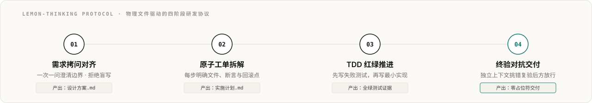
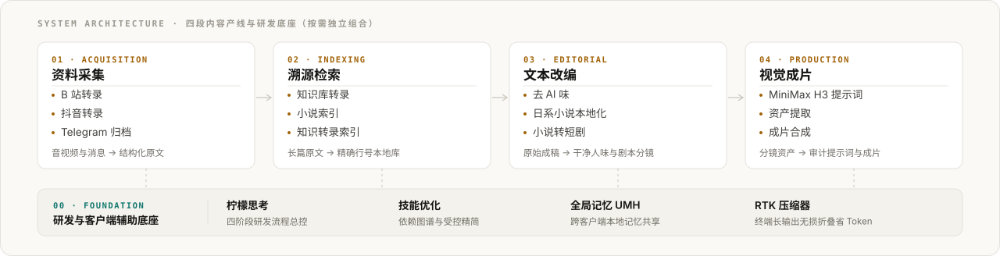
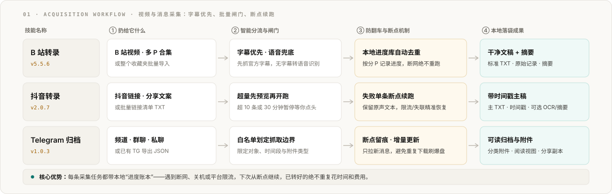
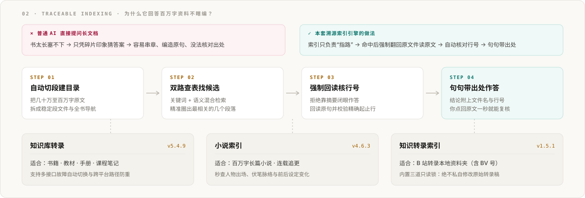
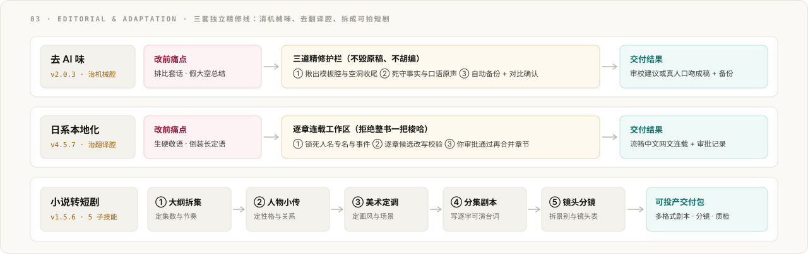
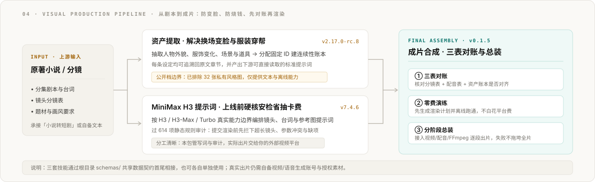
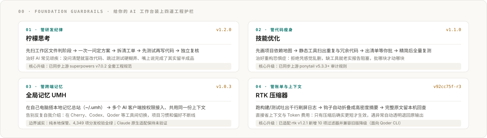

<div align="center">

<picture>
  <source media="(prefers-color-scheme: dark)" srcset="docs/assets/hero-dark.svg" />
  <source media="(prefers-color-scheme: light)" srcset="docs/assets/hero-light.svg" />
  
</picture>

<br />

[设计理念](#设计理念) · [系统架构](#系统架构) · [16 套技能图解](#技能详解) · [组合产线](PIPELINE.md) · [快速上手](#快速上手) · [验证边界](#验证边界与许可)

[**下载完整 ZIP**](https://codeload.github.com/ningmengningmeng233-sys/my-agent-skills/zip/refs/heads/main) · [版本清单](catalog.json) · [安装指南](docs/getting-started.md) · [常见问题](docs/faq.md)

<br />

[](https://github.com/ningmengningmeng233-sys/my-agent-skills/actions/workflows/ci.yml)

</div>

<br />

> **先选一套，用小样本跑通。** 这里收录的不是“几句话提示词模板”，而是从 **192 套**实战原型中严选留存下来的 **16 套独立工程化 AI 技能**，适配 **Claude Code**、**Codex**、**Antigravity** 等支持 `SKILL.md` 的客户端。每套都自带中文使用指南、自动化回归测试与防翻车断点机制，不用一次全装，按需拿走即用。

---

## 设计理念

普通人用 AI 最常遇到三个挫败：**说不清需求导致 AI 瞎发挥、长文档一多就开始胡编、做到一半断线只能重头再来。** 本仓库把工程现场的**工序拆分、质量验收、过程留痕与风险控制**搬进 AI 工作流，让每一步都变成确定性动作：

<table>
  <tr>
    <td width="33.3%" valign="top">
      <p><sub><strong>01 · 严选留存（192 → 16）</strong></sub></p>
      <p><strong>只留真正跑通的精品</strong></p>
      <p>淘汰了 91% 依赖碰运气、边界模糊的实验草稿；只保留输入输出明确、可独立安装、出问题能定位恢复的 16 套核心技能。</p>
    </td>
    <td width="33.3%" valign="top">
      <p><sub><strong>02 · 先测后写（4,515 项测试）</strong></sub></p>
      <p><strong>用硬校验替代口头保证</strong></p>
      <p>每套核心脚本自带自动化回归测试，全仓接入 Windows / Linux 双平台 CI 矩阵与跨技能数据契约门禁，改坏任何接缝立刻红灯拦住。</p>
    </td>
    <td width="33.3%" valign="top">
      <p><sub><strong>03 · 诚实留痕（绝不伪造完成）</strong></sub></p>
      <p><strong>原始文件与断点永远在场</strong></p>
      <p>明确区分“代码跑通”与“真实业务验收”。重操作默认先备份原稿、先出预览再执行；遇到缺依赖或权限不足，立刻停在边界处不糊弄。</p>
    </td>
  </tr>
</table>

<br />

<picture>
  <source media="(prefers-color-scheme: dark)" srcset="docs/assets/protocol-dark.svg" />
  <source media="(prefers-color-scheme: light)" srcset="docs/assets/protocol-light.svg" />
  
</picture>

---

## 系统架构

16 套技能构成一条完整的内容工程链条——**先采集视频与聊天资料 → 再建成可精准查出处的本地知识库 → 再去 AI 味、润色或改编成短剧剧本 → 最后审核视频提示词、管理角色资产并合成片子**；底部则由 4 套**研发与客户端辅助底座**替你管住 AI 的纪律、代码质量、记忆和费用。

<br />

<picture>
  <source media="(prefers-color-scheme: dark)" srcset="docs/assets/architecture-dark.svg" />
  <source media="(prefers-color-scheme: light)" srcset="docs/assets/architecture-light.svg" />
  
</picture>

<br />

### 按你的目标，直接跳到对应图解

| 你现在最想解决的问题 | 推荐直接看哪一组 | 快捷跳转 |
| :--- | :--- | :--- |
| 看完长视频、刷完短视频或群聊干货，想一键沉淀成干净文字笔记 | B 站转录 · 抖音转录 · Telegram 归档 | [01 · 资料采集与归档](#01--资料采集与归档) |
| 手头有几十万上百万字的书、教程或小说，想让 AI 回答且句句带原文出处 | 知识库转录 · 小说索引 · 知识转录索引 | [02 · 溯源索引与本地检索](#02--溯源索引与本地检索) |
| 稿子一股“AI 味 / 日式翻译腔”，或者想把小说系统拆成短剧分集剧本 | 去 AI 味 · 日系小说本地化 · 小说转短剧 | [03 · 文本精修与剧本改编](#03--文本精修与剧本改编) |
| 做 AI 短片怕角色换场变脸、怕提示词写错白烧抽卡费、想把分镜配音合在一起 | MiniMax H3 提示词 · 资产提取 · 成片合成 | [04 · 视觉提示词、资产与成片](#04--视觉提示词资产与成片) |
| 想让 AI 写代码别瞎改、给膨胀项目安全瘦身、多软件共享记忆、省终端 Token | 柠檬思考 · 技能优化 · 全局记忆 UMH · RTK 压缩器 | [00 · 研发流程与客户端底座](#00--研发流程与客户端底座) |

> 想把多套技能首尾串联成一条自动化产线？请看 [组合流程与交接指南（PIPELINE.md）](PIPELINE.md)。

---

## 技能详解

每个模块都由 **「工作原理图解 + 速览索引表 + 白话深度拆解」** 三部分组成。先看图 5 秒明白整组逻辑，再读你关心的单套技能——我们把每套技能拆成 **为什么需要它、它怎么防翻车、举个真实例子** 三件事讲清楚。版本以 [catalog.json](catalog.json) 为准。

---

### 01 · 资料采集与归档

<picture>
  <source media="(prefers-color-scheme: dark)" srcset="docs/assets/flow-01-acquisition-dark.svg" />
  <source media="(prefers-color-scheme: light)" srcset="docs/assets/flow-01-acquisition-light.svg" />
  
</picture>

<br />

| 技能与中文指南 | 版本 | 一句话解决什么问题 | 技能入口 |
| :--- | :--- | :--- | :--- |
| [B 站转录](docs/skills/bilibili-auto-transcript.md) | `5.5.6` | 把 B 站单个视频、多 P 课程或整个收藏夹变成干净文稿 | [SKILL.md](B站转录_v5.5.6/SKILL.md) |
| [抖音转录](docs/skills/douyin-auto-transcript.md) | `2.0.7` | 批量把抖音分享链接转成带时间戳的文字稿，支持中途续跑 | [SKILL.md](抖音转录_v2.0.7/SKILL.md) |
| [Telegram 归档](docs/skills/tg-transcript.md) | `1.0.3` | 按范围导出或整理 TG 群聊、频道消息与附件，方便长期回看 | [SKILL.md](tg转录_v1.0.3/SKILL.md) |

#### B 站转录 · `bilibili-transcript`
- **为什么需要它（裸干会踩什么坑）**：手工扒 B 站长课字幕极耗时间；普通下载工具一旦遇到“没官方字幕的视频”或“几百个视频的收藏夹中途断网”，要么直接报错卡死，要么下次全部重头下、白白重复转语音。
- **它内部怎么防翻车**：采用**“字幕优先、本地语音识别兜底”**两级策略——能直接拿到官方或 AI 字幕就不浪费算力听译，拿不到再自动切到本地语音识别模型；每个视频与分 P 的完成状态都会记进本地进度库，断网、关机或漏集，下次运行只补没完成的部分，还能按需补齐内容摘要。
- **举个具体场景**：扔给它一个 40 集的专业课 B 站合集链接或收藏夹 → 拿到按集整理好的干净 TXT 文稿、原始字幕记录与摘要状态（前置需 Python ≥ 3.10、FFmpeg 与可选本地识别模型）。

#### 抖音转录 · `douyin-auto-transcript`
- **为什么需要它（裸干会踩什么坑）**：抖音链接常常夹在一大段分享文案里，手工一条条提链接、转文字、标时间非常琐碎；批量跑多了还容易触发登录失效或限流，一旦卡在半路分不清哪些成功了、哪些需要重来。
- **它内部怎么防翻车**：把“防失控”做成了硬规则——一批任务只要新增超过 10 条或预计耗时超过 30 分钟，就会先停下来给你看执行预览，等你明确同意才真正开工；运行中把每条视频的状态清晰分成成功、需登录、待复核等类别，并死守**永不覆盖原始识别文本**的原则，出问题只需按批次号只重试失败的那几条。
- **举个具体场景**：把手机里复制出来的 25 条抖音分享文案存成一个清单文件扔给它 → 先收到预览确认，确认后产出带时间戳的主文稿、原始记录和按需开启的画面字幕 OCR / 摘要（需 Python ≥ 3.12、FFmpeg 及按需浏览器登录）。

#### Telegram 归档 · `tg-transcript`
- **为什么需要它（裸干会踩什么坑）**：Telegram 群组和频道里沉淀着大量好讨论与文件，但聊天记录刷得太快，想回顾几周前的资料翻到手软；全盘导出又太大太乱，每次更新还得重新拉一遍历史消息。
- **它内部怎么防翻车**：开工前必须先划清明确范围——只抓哪个频道/群、哪段时间、要哪几类附件，全部写进任务清单再动手；支持记录断点并做**增量更新**（下次只拉新增消息），也支持不联网直接导入你已有的 Telegram 导出文件做离线清洗和归类。
- **举个具体场景**：指定一个技术交流群最近三个月的消息与 PDF 附件 → 得到按时间整理好的可读视图、分类附件目录、可检索归档和脱敏分享副本（注：本工具专注消息与附件整理，不承诺内建语音转文字）。

---

### 02 · 溯源索引与本地检索

<picture>
  <source media="(prefers-color-scheme: dark)" srcset="docs/assets/flow-02-indexing-dark.svg" />
  <source media="(prefers-color-scheme: light)" srcset="docs/assets/flow-02-indexing-light.svg" />
  
</picture>

<br />

| 技能与中文指南 | 版本 | 一句话解决什么问题 | 技能入口 |
| :--- | :--- | :--- | :--- |
| [知识库转录](docs/skills/knowledge-index.md) | `5.4.9` | 针对几十万字书籍、手册、课程笔记做带精确行号出处的本地问答 | [SKILL.md](知识库转录_v5.4.9/SKILL.md) |
| [小说索引](docs/skills/novel-index.md) | `4.6.3` | 针对百万字长篇小说与连载追更，秒查伏笔、人物出场与原句 | [SKILL.md](小说索引_v4.6.3/SKILL.md) |
| [知识转录索引](docs/skills/transcript-index.md) | `1.5.1` | 专接 B 站本地转录文件夹，只读建索引、出校对稿与语义检索 | [SKILL.md](知识转录索引_v1.5.1/SKILL.md) |

#### 知识库转录 · `knowledge-index`
- **为什么需要它（裸干会踩什么坑）**：把一本 50 万字的专业书或几十份研报直接丢给普通 AI，它装不下全书，只能凭模糊碎片猜答案——经常把第三章和第十章张冠李戴，甚至自己编一句“书里说过的话”，你根本没法核对真假。
- **它内部怎么防翻车**：坚持一条铁律——**索引只负责“指路”，回答必须回读原文**。它先帮你把长文自动切成稳定段落并生成全书目录；你提问时，先通过关键词和语义双路检索圈出候选段落，再强制翻回原文件核对真实起止行号，最后句句附带出处作答。建索引还支持多个模型接口自动故障切换，一个通道限额了无缝切到下一个，且跨 Windows / Linux 路径完全兼容不重复建库。
- **举个具体场景**：导入 3 本行业教材和 20 份课程笔记（TXT/Markdown） → 问“书中关于风险储备金的三种计算口径分别在第几章怎么写的？” → 拿到精准归纳 + 每一条对应的具体文件与起止行号，点回去一秒核验真伪。

#### 小说索引 · `novel-index`
- **为什么需要它（裸干会踩什么坑）**：读或改编几百万字的长篇连载小说时，最头疼的就是“前面第 42 章埋的伏笔后面到底回收没有”“男主佩剑的名字前后有没有写串”。靠 Ctrl+F 搜关键词经常漏掉同义表述，靠 AI 记忆又极容易记混剧情。
- **它内部怎么防翻车**：专门按小说的章节与自然段结构建立稳定的本地原文段库与全书章节导航，把正文和索引保存在你自己的独立数据目录里；连载更新了不需要推倒重来，直接增量追更新章节并保持索引健康，既适合读者深挖剧情，也是后续做“小说转短剧”前最稳妥的设定查证底座。
- **举个具体场景**：导入一部 180 万字的仙侠小说 → 快速定位某个配角全部出场章节与原对话，或在新更新 30 章后一键追更入库，所有查证结论都能直接回到原文章节核对。

#### 知识转录索引 · `knowledge-transcript-index`
- **为什么需要它（裸干会踩什么坑）**：用「B 站转录」攒了几百篇课程和访谈文字稿在本地（例如 Obsidian 笔记库）后，资料越堆越多却很难跨视频综合检索；同时普通批处理脚本一不小心就可能把你辛辛苦苦整理的原始笔记改乱。
- **它内部怎么防翻车**：为 B 站转录文稿量身定制，出厂自带三道硬核保护锁——只认带合规 BV 号的转录文件、**严禁回写修改你的原始转录稿**、不私自篡改你的术语表；没填好资料目录路径时直接安全拦截不乱跑。
- **举个具体场景**：指向你存放 B 站转录稿的本地目录，先用 `--dry-run` 零风险预览，再生成独立的索引库、可读校对版和本地向量检索视图（提示：离线核心测试全绿；真实本地笔记目录与嵌入模型仍建议先拿 3 份样本隔离试跑）。

---

### 03 · 文本精修与剧本改编

<picture>
  <source media="(prefers-color-scheme: dark)" srcset="docs/assets/flow-03-editorial-dark.svg" />
  <source media="(prefers-color-scheme: light)" srcset="docs/assets/flow-03-editorial-light.svg" />
  
</picture>

<br />

| 技能与中文指南 | 版本 | 一句话解决什么问题 | 技能入口 |
| :--- | :--- | :--- | :--- |
| [去 AI 味](docs/skills/lieflat-less-ai-tone.md) | `2.0.3` | 去掉稿件里假大空的机械 AI 腔，同时绝不乱改事实与你的说话风格 | [SKILL.md](去AI味_v2.0.3/SKILL.md) |
| [日系小说本地化](docs/skills/jp-novel-localization.md) | `4.5.7` | 把日式翻译腔初稿逐章精修成读着顺口的中文网文连载 | [SKILL.md](日系小说本地化_v4.5.7/SKILL.md) |
| [小说转短剧](docs/skills/dramacraft.md) | `1.5.6` | 用 5 道专业工序把小说从大纲、人设、美术一路拆成可拍短剧剧本与分镜 | [SKILL.md](小说转短剧_v1.5.6/SKILL.md) |

#### 去 AI 味 · `lieflat-less-ai-tone`
- **为什么需要它（裸干会踩什么坑）**：直接对普通 AI 说“帮我润色得像人写的”，它常常干两件坏事——要么换汤不换药，依然满篇“不仅如此、综上所述、赋能升华”；要么为了文采擅自编造数据、改掉你的立场、把你原本接地气的口语磨平。
- **它内部怎么防翻车**：专门针对中文和中英混合文本，精准识别高频 AI 模板句与空洞总结收尾，同时有意识地保护作者原本的口语习惯与真实态度，并**明确禁止为了凑效果去编造原文没有的事实**；改文件之前自动留原稿备份，先让你看到前后差异对比，你点头确认后才落盘，也可以选择“只给修改建议，不动我原文”。
- **举个具体场景**：扔给它一篇 3,000 字带着浓重机器腔的公众号初稿或项目总结，标出不能改的数据与专词 → 先拿到逐条审校诊断或对比预览，确认后得到干净自然、像真人手写的定稿与改前备份。

#### 日系小说本地化 · `jp-novel-localization`
- **为什么需要它（裸干会踩什么坑）**：日系轻小说或机翻初稿往往充斥着“如此这般”“竟然会是这样的吗”“那个穿着黑色外套的站在门口的少年”之类拗口翻译腔；但如果把整本书丢给 AI 一口气温润改写，改到第 5 章人名就变了、关键剧情也被吞了。
- **它内部怎么防翻车**：坚决反对整书一把梭哈——搭建了一套严格的**连载编辑工作区**：先确认章节边界、把人名地名和核心剧情事件锁进约束表，再逐章产出候选稿、自动核对专名与剧情有没有走样，等你逐章审批通过后，最后再安全合并分章（当前工作区入口适配 Windows PowerShell）。
- **举个具体场景**：把一段 10 章的日系机翻中文稿放进工作区，定好人名表与目标中文网文节奏 → 逐章审查批准，最后合并出一套读起来丝滑自然、设定零串味的中文连载章节。

#### 小说转短剧 · `dramacraft`
- **为什么需要它（裸干会踩什么坑）**：直接让 AI“把这本小说改成 10 集短剧”，出来的往往是流水账梗概——没有卡点钩子、台词像念说明书、人物性格前后割裂，根本没法直接拿去配音或生成视频分镜。
- **它内部怎么防翻车**：把短剧编剧拆成 **5 个专业子技能流水线**：**① 大纲拆集**（定集数、单集时长与节奏钩子）→ **② 人物小传**（定人设与冲突关系）→ **③ 美术定调**（定画面风格与主场景）→ **④ 分集剧本**（写逐字可演台词）→ **⑤ 镜头分镜**（拆成带景别和动作的分镜表），并输出专门的质量体检报告，产物结构直接对齐下游的视觉提示词与成片合成模块。
- **举个具体场景**：提供小说正文、改编大纲与“20 集、每集 2 分钟、都市悬疑风”的要求 → 产出可审阅的多格式分集剧本（Markdown / CSV / JSON / HTML）、质量评估报告以及可直接交给下游的镜头分镜数据。

---

### 04 · 视觉提示词、资产与成片

<picture>
  <source media="(prefers-color-scheme: dark)" srcset="docs/assets/flow-04-production-dark.svg" />
  <source media="(prefers-color-scheme: light)" srcset="docs/assets/flow-04-production-light.svg" />
  
</picture>

<br />

| 技能与中文指南 | 版本 | 一句话解决什么问题 | 技能入口 |
| :--- | :--- | :--- | :--- |
| [MiniMax H3 提示词](docs/skills/minimax-h3-craft.md) | `7.4.6` | 按型号能力编写并严格审计 H3 视频提示词，提交前拦住废片 | [SKILL.md](MiniMaxH3提示词_v7.4.6/SKILL.md) |
| [资产提取](docs/skills/asset-extract.md) | `2.17.0-rc.8` | 跨章节提取人物外貌、服饰与场景固定档案，防换场变脸穿帮 | [SKILL.md](资产提取_v2.17.0-rc.8/SKILL.md) |
| [成片合成](docs/skills/media-assembly.md) | `0.1.5` | 先核对分镜、配音与资产三本账，再离线演练并分阶段组装成片 | [SKILL.md](成片合成_v0.1.5/SKILL.md) |

#### MiniMax H3 提示词 · `minimax-h3-craft`
- **为什么需要它（裸干会踩什么坑）**：AI 视频生成很贵，很多废片不是模型不行，而是提示词本身踩了雷——比如给不支持长镜头的模式写了 15 秒复杂运镜、台词字数超了口型极限、或者不同型号（H3 / H3-Max / H3-Max-Turbo）的能力混为一谈，结果反复抽卡白烧钱。
- **它内部怎么防翻车**：内置各型号真实能力对照表与 **614 项静态规则审计**，像上线前的严格安检员一样，在你花钱提交视频平台之前，先帮你把镜头、时长、台词、参考图和模式规则逐条对齐，缺什么资料、哪一条超限直接红牌指出来。
- **举个具体场景**：把「小说转短剧」产出的分镜和目标模型（如 H3-Max）交给它 → 拿到按规范排好、通过 614 项规则体检的标准视频提示词与待补清单（提示：本技能管写词与审词，最终渲染出片在你的外部视频平台进行）。

#### 资产提取 · `asset-extract`
- **为什么需要它（裸干会踩什么坑）**：做长篇小说改编动画或漫剧时，最容易崩盘的就是一致性——第一章主角穿玄色长袍、左眉有疤，到了第八章 AI 忘了设定，直接变成白衣书生，场景建筑也一集换一个样。
- **它内部怎么防翻车**：通读你按顺序排好的小说文档（支持 TXT / Markdown / DOCX / EPUB），系统性抽出每一个人物、服饰状态变化、核心场景与关键道具，给它们分配**永不漂移的固定身份证编号（ID）**与人物关系图谱，每一条视觉描述都能追溯回原文章节，并沉淀成下游可直接读取的过程账本。
- **举个具体场景**：先用 `--dry-run` 预览步骤，再导入一部古风小说 → 拿到完整的人物/场景/服饰文本资产库、跨章节变化账本与标准提示词（**公开版诚实说明**：按 `CAPABILITIES.md` 已移除 32 张仅限个人私用的风格参考图，因此公开版仅含文本提取与离线能力，暂保持 `-rc.8` 预发布号）。

#### 成片合成 · `media-assembly`
- **为什么需要它（裸干会踩什么坑）**：前面剧本、分镜、配音、角色设定分别由不同环节产出，真正准备合成片子时，最怕发现“镜头 12 的角色编号对不上资产表”“配音漏了两句台词”——直接拿去调付费渲染接口，跑一半报错整条片子报废。
- **它内部怎么防翻车**：坚持**“先三表对账、再零费演练、最后分阶段出片”**。先把上游交过来的分镜表、配音表和资产账本全量核对一遍，生成一份清晰的渲染施工计划；默认提供离线演练模式，让你不花一分钱先把全流程跑通确认无误，之后再接入你的真实视频/配音服务与 FFmpeg 分阶段组装，哪怕单个镜头失败也只记单条失败日志，绝不拖垮整集成果。
- **举个具体场景**：汇入上游的三份标准清单（分镜、配音、资产账本） → 先拿到对账无误的渲染计划并离线跑通演练，再接入真实平台账号分阶段输出可人工播放验收的成片。

---

### 00 · 研发流程与客户端底座

<picture>
  <source media="(prefers-color-scheme: dark)" srcset="docs/assets/flow-00-foundation-dark.svg" />
  <source media="(prefers-color-scheme: light)" srcset="docs/assets/flow-00-foundation-light.svg" />
  
</picture>

<br />

| 技能与中文指南 | 版本 | 一句话解决什么问题 | 技能入口 |
| :--- | :--- | :--- | :--- |
| [柠檬思考](docs/skills/lemon-thinking.md) | `1.2.0` | 当 AI 写代码的“总包监理”，按真实文件证据严管从需求到验收全流程 | [SKILL.md](柠檬思考_v1.2.0/SKILL.md) |
| [技能优化](docs/skills/skill-optimization.md) | `1.1.0` | 给越写越臃肿的代码库做“有证据、先审批、后复测”的安全瘦身 | [SKILL.md](技能优化_v1.1.0/SKILL.md) |
| [全局记忆 UMH](docs/skills/universal-memory-hub.md) | `1.0.3` | 让一台电脑上的多个 AI 客户端共用同一份本地记忆，换工具不断线 | [SKILL.md](全局记忆UMH_v1.0.3/SKILL.md) |
| [RTK 压缩器](docs/skills/rtk-token-reducer.md) | `92cc75f-r3` | 自动折叠命令行几千行刷屏日志省 Token，同时保留完整原文随时回查 | [SKILL.md](rtk-token-reducer_v92cc75f-r3/SKILL.md) |

#### 柠檬思考 · `lemon-thinking`
- **为什么需要它（裸干会踩什么坑）**：让 AI 帮你做新功能或修 Bug 时，最容易遇到“你才说了一句，它没问清楚就一口气乱改 10 个文件”“跳过验证直接说修好了，结果一跑全报错”“聊到后面忘了前面定好的方案”。
- **它内部怎么防翻车**：作为整套研发总控，它绝不凭感觉瞎动——一上来先静默检查你项目文件夹里的真实文件证据（有没有设计方案、有没有工单、有没有测试），准确判定当前走到哪一步，再严格推进**需求拷问对齐 → 拆清原子工单 → 先写测试再写代码 → 独立挑错验收**四道关卡（已同步上游 `superpowers v7.0.2` 完整工程纪律）。
- **举个具体场景**：对 AI 说“用柠檬思考帮我重构这个工具” → 它不会立刻乱改代码，而是先逐一问清边界、落盘清晰方案和工单，经你确认后一步一测稳步交付。

#### 技能优化 · `skill-optimization`
- **为什么需要它（裸干会踩什么坑）**：项目迭代久了，到处都是重复脚本和半废弃代码；想让 AI 帮忙精简，又怕它凭直觉把藏在角落的关键逻辑顺手删了，精简完整个项目跑不起来。
- **它内部怎么防翻车**：用三层客观证据管住瘦身风险——先画项目依赖地图搞清谁调用谁，再用静态审计工具（已同步上游 `ponytail v5.3.3+` 规范）揪出真正的重复与冗余，按优先级列好清单等你批复；只动你明确批准的范围，改完由独立视角复核测试；缺检查工具时老实报告阻塞，绝不拿口头猜测冒充体检结论。
- **举个具体场景**：指定一个膨胀已久的仓库和必须保住的核心测试 → 先拿到客观的依赖结构与精简建议单，你勾哪项它改哪项，改完跑全量测试交验收报告。

#### 全局记忆 UMH · `universal-memory-hub`
- **为什么需要它（裸干会踩什么坑）**：现在很多人电脑上同时装了好几个 AI 客户端（比如 Cherry、Codex、Qoder、ZCode 等），结果你在 A 工具里刚讲清自己的写作偏好和项目背景，切到 B 工具又得从头自我介绍一遍，记忆支离破碎。
- **它内部怎么防翻车**：在你自己电脑上搭起一座纯本地运行的共享记忆总站（默认存在 `~/.umh`），不把隐私上传第三方云端；自带 4,349 项随包文件双向完整性校验和逐客户端信任审阅，你允许哪些工具接入、保存什么记忆全由你决定，接入后先用一条测试记忆核实写入与回读再正式启用。
- **举个具体场景**：按指引启动本地记忆服务并接入你的常用客户端 → 在工具 A 记下一条项目规范，切到工具 B 直接能召回延续上下文（需 Node.js ≥ 24.2 与 Python ≥ 3.12；Claude 原生适配目前仍保持未验证边界）。

#### RTK 压缩器 · `rtk-token-reducer`
- **为什么需要它（裸干会踩什么坑）**：AI 编程工具运行构建、全量测试或 `git diff` 时，终端动辄吐出几千行重复日志——这些垃圾行全塞进对话上下文里，既迅速挤爆 AI 记忆窗口导致变笨，又白白烧掉大量 Token 费用。
- **它内部怎么防翻车**：挂在 CLI 工具的执行钩子上自动给长输出“挤水分”（已适配 `rtk v1.2.1` 新增 10 项过滤器并兼容旧版降级）；遵循极度稳妥的安全策略——**只有压缩后确实更短才替换**，任何异常都会无感退回原始输出，并且每一份完整原始日志都妥善存在本机随时回查，绝不丢关键报错。
- **举个具体场景**：在 Qoder CLI 中跑一次输出 3,000 行日志的全量测试 → AI 只收到几十行高密度摘要（省下大部分上下文与费用），需要追查某一行细节时直接按路径回读本机完整原稿（面向 Qoder CLI，依赖可用 `rtk` 与 Python）。

---

## 快速上手

### 1 · 下载完整目录

点击 [下载最新 main 分支 ZIP](https://codeload.github.com/ningmengningmeng233-sys/my-agent-skills/zip/refs/heads/main) 解压，或直接克隆仓库：

```powershell
git clone https://github.com/ningmengningmeng233-sys/my-agent-skills.git
cd my-agent-skills
```

> **重要提醒**：请始终复制所需技能的**完整文件夹**，不要只复制单个 `SKILL.md`；也无需一次安装全部 16 套依赖，用哪套再装哪套。

### 2 · 单套小样本跑通

1. 在上方图解中选定一套技能，点开它的**中文使用指南**，先看环境要求与能力边界。
2. 把完整文件夹放入你的 AI 客户端技能目录（宿主按入口 `SKILL.md` 里的英文 `name` 识别），再按包内安装文档准备该技能独立依赖。
3. 先跑环境检查或 `--dry-run` 预览，再用**一条视频 / 一篇短文 / 一章小说 / 一条测试记忆**走通闭环，核对无误后再扩大批次。

更完整的安装步骤、客户端差异、备份与回退指南见 [从下载到第一次使用](docs/getting-started.md)。

### 3 · 全仓一键体检与干净打包

仓库自带根级维护脚本 `scripts/cabinet_tools.py`，用于校验全仓规范，或自动打干净的单包分发 ZIP（自动排除 `.env`、`.venv`、`state`、`output` 等本机私密数据）：

```powershell
# 全仓元数据、许可声明、CI 矩阵与跨技能契约一键体检
python scripts/cabinet_tools.py check

# 查看全部 16 套公开技能版本与技能名总览
python scripts/cabinet_tools.py status

# 为全部或指定单套技能生成干净分发包与校验清单（输出至 dist/）
python scripts/cabinet_tools.py pack --all
python scripts/cabinet_tools.py pack --id lemon-thinking
```

---

## 验证边界与许可

- **外部服务与费用**：纯规则检查与离线演练无需外部计费；涉及语音识别、建索引、改写或视频平台渲染时，按你的本机配置消耗本地算力或外部接口额度，请先确认内容授权、隐私范围与预算。
- **数据主权与备份**：密钥、Cookie、登录会话、原稿与数据库全部留在你自己的本机目录；执行大批量处理、改写或升级前请先做好备份。

<details>
<summary><strong>客观能力边界与已知限制（点击展开）</strong></summary>

<br />

本仓库坚持区分**本地工程验证**与**真实业务验收**，以下边界请在使用前知悉（完整说明见 [验证范围与限制](docs/verification.md) 与 [常见问题](docs/faq.md)）：

- **资产提取公开档（`2.17.0-rc.8`）**：按 `CAPABILITIES.md` 已排除 32 张仅授权本机私用的风格/来源参考图，相关视觉生图与画质一致性验收在公开档不可用；离线文本核心测试全绿且校验清单已重算对齐，按闸门保持 `-rc.8` 预发布号。
- **知识转录索引（`1.5.1`）**：导入安全保护与 9 项离线核心回归测试全绿；真实本地 Obsidian 转录目录与嵌入模型检索仍需先用小样本 `--dry-run` 在本机核验。
- **全局记忆 UMH（`1.0.3`）**：Python 回归与 Node 随包 4,349 项文件完整性检查全绿；各客户端原生接入须在接收机逐端验证，Claude 原生兼容性保持 `UNVERIFIED`。
- **MiniMax H3 提示词（`7.4.6`）**：614 项静态规则回归全绿，但不代替外部视频平台的真实渲染出片与人工播放验收。
- **跨平台与真实账号链路**：全仓 CI 已覆盖 16 套技能 × Windows / Linux 双平台自动化单测与契约门禁；但真实平台账号会话、限流波动与付费模型出片效果仍以你的本机实测为准。

</details>

<details>
<summary><strong>开源许可、第三方上游与分层边界（点击展开）</strong></summary>

<br />

- 本仓库**不统一授予单一 MIT 许可**；16 套技能及其包含的第三方组件分别遵循各自目录内的 `LICENSE`、`UPSTREAM`、`PROVENANCE` 或 `THIRD_PARTY_NOTICES` 分层声明（例如 `B站转录` 已明确区分上游 MIT 代码与本地自有脚本边界）。
- 上游原版致谢：`柠檬思考` 同步参考 `obra/superpowers`（v7.0.2），`技能优化` 同步参考 `DietrichGebert/ponytail`（v5.3.3+），`RTK 压缩器` 适配 `rtk`（v1.2.1 过滤器规则），`去 AI 味` 择优吸收 `blader/humanizer`（v4.0.0+ 口语保护与空洞收尾检查）。
- 公开可下载不自动等同于可商用、可转授权或可再分发受限素材，使用前请以所在技能包的许可文件为准。

</details>

---

## 关于作者

> **柠檬才不萌** · AI 应用 / Agent 工作流实践者。
>
> 工程造价与施工现场出身，把**工序拆解、质量验收、过程留痕和风险控制**带进 AI 工作流：让 Agent 的每一步都可拆、可测、可追溯。

---

<div align="center">

<sub>Rev 2026.11.24 · 16 Public Skills · <a href="catalog.json">catalog.json</a> · <a href="PIPELINE.md">PIPELINE.md</a> · <a href="docs/verification.md">verification.md</a></sub>

</div>
